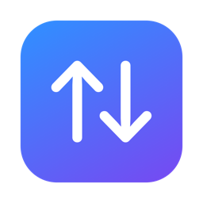

<p align="center">
  
</p>

<h1 align="center">AllDrop</h1>

<p align="center">
  <b>AirDrop-style sharing between your Mac and Android phones.</b><br>
  Send and receive files, links and text with Samsung Quick Share / Google Quick Share. Free and open source.
</p>

<p align="center">
  <a href="https://github.com/AndrewXuTurtle/AllDrop/releases/latest">Download</a> ·
  <a href="#how-to-use">How to use</a> ·
  <a href="#faq">FAQ</a> ·
  <a href="CONTRIBUTING.md">Contribute</a>
</p>

---

Got a MacBook and an Android phone? AirDrop doesn't work between them, so you end up emailing yourself photos or hunting for a cable. **AllDrop makes your Mac show up in the phone's Quick Share list** like any other Android device, and lets you send files back to the phone.

- 📲 **Phone → Mac.** Share → Quick Share → pick your Mac. Files land in Downloads.
- 💻 **Mac → Phone.** Drop files on the menu-bar or Dock icon, then scan a QR code with the phone.
- 🔗 **Links and text.** Links open in your browser. Text goes to your clipboard.
- 🔒 **End-to-end encrypted**, with the same PIN check as Quick Share. Everything stays on your Wi-Fi, with no account, cloud or tracking.
- 🆓 **Free forever** under the MIT license.

Works with Samsung Galaxy (One UI), Pixel, and any Android phone with Google Play services.

## Install

1. Download `AllDrop-vX.Y.Z.zip` from [Releases](https://github.com/AndrewXuTurtle/AllDrop/releases/latest) and unzip it.
2. Move **AllDrop.app** to **Applications**.
3. The first time you open it, macOS says it can't verify the developer, because AllDrop isn't notarized by Apple (that costs $99/year). Go to **System Settings → Privacy & Security**, scroll down, and click **Open Anyway**.
   Or, in Terminal: `xattr -dr com.apple.quarantine /Applications/AllDrop.app`
4. Allow **Local Network** access when asked.

Or build it yourself. See [Building](#building).

## How to use

### Receive on your Mac

1. Keep AllDrop running. It sits in the menu bar and, optionally, in the Dock.
2. On the phone: **Share → Quick Share** and pick your Mac.
3. Check that the PIN matches, then click **Accept** on the Mac.

> The phone's Quick Share visibility must be **Everyone** (*Quick Share settings → Who can share with you*), and both devices must be on the same Wi-Fi.

### Send to your phone

Any of these opens the send window:

- Drag files onto the **menu-bar icon**, the **Dock icon**, or the AllDrop window.
- In Finder: **right-click → Quick Actions/Services → Send with AllDrop**.
- **Send Clipboard** in the menu sends whatever you copied (files, a link, or text).

Then **scan the QR code with your phone's camera**. The transfer starts on its own.

> **Why a QR code?** Phones only become visible after hearing a Bluetooth beacon, and macOS doesn't let apps send that beacon. The QR code is the official Quick Share way around it. Phones that are already open to receive also appear in the "nearby" list.

## FAQ

**My Mac doesn't show up on the phone.**
Make sure both devices are on the same Wi-Fi and the phone's visibility is *Everyone*. Some public, hotel and office networks block devices from seeing each other; a phone hotspot works as a fallback (connect the Mac to it).

**Does it work with Huawei / HarmonyOS?**
Not yet. Huawei Share is a different, closed protocol, and Huawei phones without Google services don't have Quick Share.

**Does it work with iPhone?**
Use AirDrop for that 🙂

**Is it safe?**
Every transfer is end-to-end encrypted (UKEY2 key exchange, AES-256 + HMAC-SHA256). You accept every incoming transfer, and the PIN shown on both screens proves who you're talking to. Nothing leaves your local network.

## Building

Requires macOS 14+ and Xcode 16.3+.

```bash
swift test               # unit + loopback transfer tests
./scripts/build-app.sh   # → build/AllDrop.app
open build/AllDrop.app
```

| Path | |
| --- | --- |
| `Sources/QuickShare` | The protocol as a reusable Swift library (no UI) |
| `Sources/AllDrop` | The macOS app |
| `Tests/QuickShareTests` | Crypto tests plus real end-to-end transfers over loopback |
| `Protos` | Google's Quick Share protocol definitions (Apache 2.0) |

To publish a release, push a tag such as `git tag v0.2.0 && git push --tags`. GitHub Actions builds the app and attaches it to the release.

## Roadmap

- [ ] Finder Share-menu extension
- [ ] Auto-accept from trusted phones
- [ ] Choose the download folder
- [ ] Homebrew cask
- [ ] Localizations (Bahasa Indonesia first!)

Ideas and pull requests are welcome. See [CONTRIBUTING.md](CONTRIBUTING.md).

## Credits

- Protocol research by [NearDrop](https://github.com/grishka/NearDrop) and its [protocol notes](https://github.com/grishka/NearDrop/blob/master/PROTOCOL.md). AllDrop is an independent implementation.
- Protocol definitions © Google LLC, Apache 2.0.
- Quick Share is a trademark of Google LLC / Samsung. AllDrop is not affiliated with Google or Samsung.

Made with ❤️ by **Kasih Murni Semesta**. AllDrop is MIT licensed.
